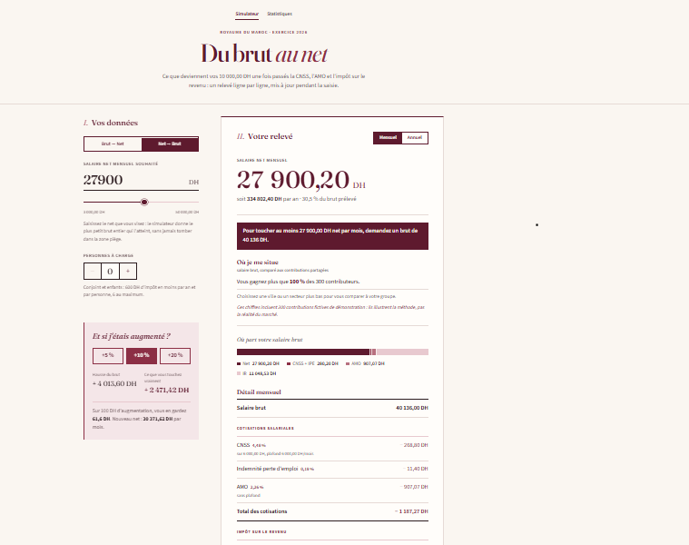
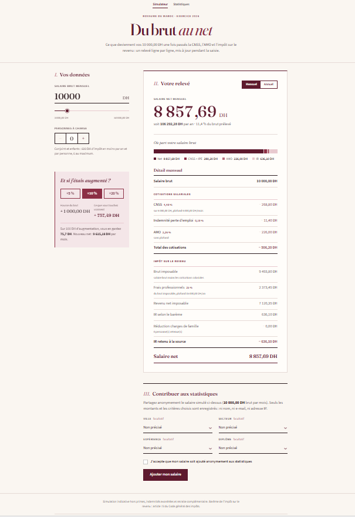
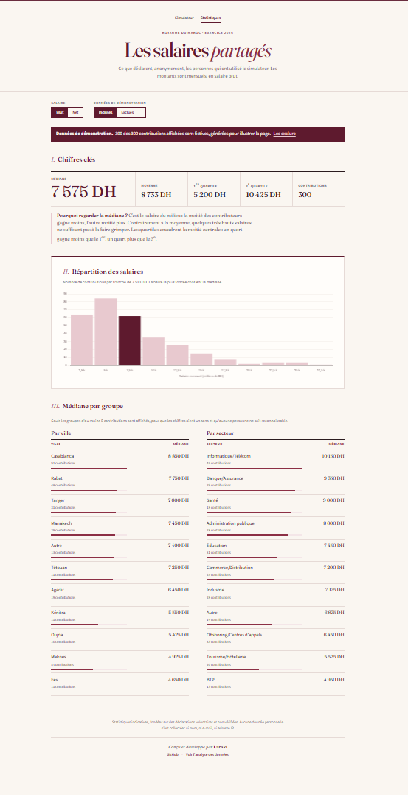
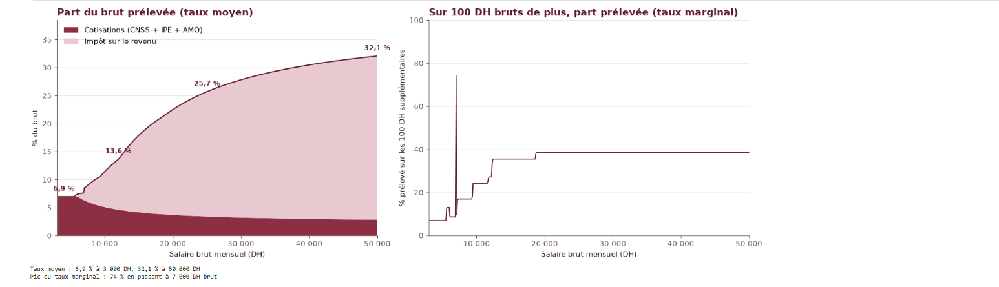

# Simulateur de salaire net — Maroc 2026

Calcule en temps réel le salaire net d'un salarié marocain à partir de son brut, ligne par ligne, et
permet de partager anonymement son salaire pour construire des statistiques ouvertes.

**Site en ligne : [simulateur-salaire-maroc.vercel.app](https://simulateur-salaire-maroc.vercel.app)**



*Au seuil des frais professionnels, une hausse du brut peut faire baisser le net : le mode
négociation donne le brut à demander pour un net visé sans jamais proposer un brut de cette
« zone piège ».*



| Statistiques des salaires partagés | Analyse des données (notebook) |
|---|---|
|  |  |

## Fonctionnalités

- **Calcul brut → net** conforme aux règles 2026 : CNSS et indemnité pour perte d'emploi (plafonnées
  à 6 000 DH), AMO, frais professionnels, barème progressif de l'impôt sur le revenu (art. 73 CGI),
  réduction pour charges de famille.
- **Relevé détaillé**, mis à jour pendant la saisie, en vue mensuelle ou annuelle, avec la
  répartition du brut entre net, cotisations et impôt.
- **Scénarios d'augmentation** (+5 %, +10 %, +20 %) : combien de dirhams d'une augmentation
  arrivent réellement sur la fiche de paie.
- **Alerte « zone piège »** : jusqu'à 150 DH sous le seuil des frais professionnels, le site
  prévient qu'une petite augmentation ferait perdre du net et indique le montant minimum à
  négocier ; entre le seuil et le brut de rattrapage, il signale que l'on toucherait plus avec un
  brut plus bas. L'alerte apparaît aussi dans l'encart des augmentations, avec une explication en
  trois phrases.
- **Mode négociation (net → brut)** : on saisit le net voulu, le site donne le plus petit brut
  entier qui l'atteint. Comme le net baisse au seuil, la recherche se fait de part et d'autre de
  celui-ci : aucun brut situé dans la zone piège n'est jamais proposé.
- **« Où je me situe »** : sous le résultat, la part des contributeurs qui gagnent moins, puis la
  même chose pour la ville et le secteur choisis (groupes d'au moins 5 contributions), avec une
  mention claire quand des données de démonstration sont incluses.
- **Contribution anonyme** de son salaire, avec ville, secteur, expérience et diplôme facultatifs.
- **Page de statistiques** : médiane, moyenne, quartiles, histogramme, médianes par ville et par
  secteur, en brut ou en net, avec ou sans les données de démonstration.
- **API JSON** : `/api/calcul`, `/api/brut-pour-net`, `/api/position`, `/api/contributions` et
  `/api/sante`.

## Stack technique

| Domaine | Outils |
|---|---|
| Application web | Python, Flask, Jinja2 |
| Données | SQLAlchemy ; PostgreSQL hébergé sur Supabase en production, SQLite en local |
| Interface | HTML, CSS, JavaScript sans framework, Chart.js |
| Analyse | Jupyter, pandas, numpy, matplotlib |
| Tests | pytest |
| Hébergement | Vercel (fonction Python serverless, CDN pour les fichiers statiques, cron quotidien) |

Tous les paramètres légaux (taux, plafonds, barème) sont regroupés dans `config.py` : une mise à
jour de la loi de finances ne demande de modifier que ce fichier.

## Validation du calcul

Les résultats ont été comparés, salaire par salaire, à ceux d'un simulateur de référence. Un écart
d'environ **50 DH par mois** est apparu sur certains salaires (51 DH pour un brut de 6 600 DH, par
exemple).

**Cause.** Les frais professionnels étaient calculés sur le salaire brut. Or, selon l'article 59 du
Code général des impôts, ils se calculent sur le **brut imposable**, c'est-à-dire le brut diminué
des cotisations salariales (CNSS, IPE, AMO). Le seuil de 78 000 DH par an, qui fait passer le taux
de 35 % à 25 %, et le plafond de 35 000 DH s'appliquent donc eux aussi au brut imposable.

**Correction.**

- la formule de `calcul.py` utilise désormais le brut imposable, affiché aussi dans le relevé ;
- des tests ont été ajoutés autour du seuil (6 500, 6 600, 6 936 et 6 937 DH brut) et les valeurs
  attendues des tests existants ont été recalculées ;
- le script `recalculer_nets.py` recalcule les salaires nets déjà enregistrés dans la base.


## Analyse des données

Le notebook [`analyse/analyse_salaires.ipynb`](analyse/analyse_salaires.ipynb) répond à deux
questions : quel est le salaire typique des contributeurs, et qu'est-ce qui le fait varier ? Il
couvre la qualité des données, le nettoyage des valeurs aberrantes (méthode de l'écart
interquartile), les statistiques descriptives, les médianes par groupe et le taux de prélèvement
effectif de 3 000 à 50 000 DH.

**Effet de seuil découvert.** Le passage des frais professionnels de 35 % à 25 % se fait d'un coup,
pour un brut d'environ 6 937 DH par mois. Juste à ce niveau, une augmentation **fait baisser** le
salaire net : de 6 936 à 6 937 DH brut, le net passe de 6 409,94 DH à 6 345,86 DH, soit 64 DH de
moins pour 1 DH de plus. Il faut 72 DH bruts supplémentaires (7 008 DH) pour retrouver le net de
départ. Le taux marginal de prélèvement atteint alors 74 %, contre moins de 40 % sur tout le reste
de la plage étudiée. Le barème de l'impôt lui-même ne présente pas ce défaut : c'est l'abattement
pour frais professionnels, en marche d'escalier, qui le provoque.

**Confirmé par un simulateur de référence.** Ce simulateur ne retient pas l'indemnité pour perte
d'emploi (IPE). Dans ce cas, le seuil se situe entre 6 925 et 6 926 DH brut, et le net passe de
6 410,54 DH à 6 346,45 DH. Avec la même hypothèse, `calcul.py` trouve le même seuil et la même
baisse, à 1 centime près : le simulateur de référence arrondit chaque ligne avant de faire la
soustraction, alors que `calcul.py` arrondit seulement le net final. Ce cas est couvert par les tests.

Pour ouvrir le notebook en local, depuis le dossier `analyse/` (il lit `../instance/simulateur.db`) :

```bash
cd analyse
jupyter notebook analyse_salaires.ipynb
```

## Confidentialité

- **Contributions anonymes** : seuls le brut, le net calculé, le nombre de personnes à charge et
  les critères choisis sont enregistrés. Aucun nom, e-mail ou adresse IP n'est stocké.
- **Consentement explicite** : rien n'est enregistré lors d'une simple simulation. Le salaire n'est
  ajouté qu'après un clic sur un bouton dédié et une case de consentement cochée.
- **Groupes de 5 minimum** : une ville ou un secteur n'apparaît dans les statistiques qu'à partir
  de 5 contributions, pour qu'aucune personne ne soit reconnaissable.
- **Base protégée** : la sécurité au niveau des lignes (Row Level Security) est activée sur
  Supabase, ce qui bloque tout accès à la table par l'API publique de Supabase. Seule l'application,
  côté serveur, lit et écrit les données.
- **Positionnement sans trace** : le calcul « Où je me situe » ne fait que lire la base. Il
  n'enregistre rien et ne dépose aucun cookie.
- Une contribution par navigateur toutes les 24 heures, et seuls les bruts entre 2 500 et
  200 000 DH sont acceptés, pour limiter les abus.

## Installation en local

Prérequis : Python 3.13 ou plus récent.

```bash
git clone https://github.com/Laraki-Yacout/simulateur-salaire-maroc.git
cd simulateur-salaire-maroc
python -m venv venv
venv\Scripts\activate          # macOS / Linux : source venv/bin/activate
pip install -r requirements.txt
python seed_demo.py            # facultatif : 300 contributions fictives
python app.py                  # puis ouvrir http://127.0.0.1:5000
```

En local, l'application utilise un fichier SQLite créé automatiquement dans `instance/`. Les tests
se lancent avec `pytest`.

## Mise en ligne

Le site est hébergé sur Vercel, qui détecte Flask, installe `requirements.txt` et utilise la version
de Python indiquée dans `.python-version`. Deux variables d'environnement sont à définir dans
Vercel :

| Variable | Valeur |
|---|---|
| `DATABASE_URL` | Chaîne de connexion Supabase, *Transaction pooler* (port 6543) |
| `SECRET_KEY` | Une longue valeur aléatoire : `python -c "import secrets; print(secrets.token_hex(32))"` |

L'application est adaptée au *Transaction pooler* : aucune connexion gardée ouverte entre deux
requêtes et pas de requêtes préparées. Les tables sont créées au premier appel.

**Maintien en activité.** Supabase met en pause les projets gratuits après une semaine sans
activité. Un cron Vercel, déclaré dans `vercel.json`, appelle chaque jour à 6 h (UTC) la route
`/api/sante`, qui interroge la base. Une exécution par jour est le maximum autorisé par l'offre
Hobby de Vercel, et largement suffisant ici.

## Organisation du code

| Fichier | Rôle |
|---|---|
| `config.py` | Paramètres légaux 2026 et réglages du site |
| `calcul.py` | Calcul brut → net, seuil des frais pro, zone piège, recherche net → brut |
| `app.py` | Routes Flask, API JSON, messages de la zone piège, page de statistiques |
| `models.py` | Table `contributions` (aucune donnée personnelle) |
| `statistiques.py` | Médiane, quartiles, histogramme, médianes par groupe |
| `seed_demo.py` | Génère des contributions fictives, marquées comme telles |
| `recalculer_nets.py` | Recalcule les nets enregistrés après un changement de règle de calcul |
| `public/static/` | CSS et JavaScript, servis par le CDN de Vercel |
| `analyse/` | Notebook d'analyse des données |
| `tests/` | Tests pytest (calcul, zone piège, négociation, positionnement, API, déploiement) |

## Limites

- **Échantillon non représentatif** : seuls les visiteurs du site contribuent, et seulement s'ils le
  souhaitent. Ce sont probablement des personnes plus connectées, plus urbaines et plus diplômées
  que la moyenne des salariés marocains.
- **Données de démonstration** : tant que les contributions réelles sont peu nombreuses, la base
  contient 300 salaires fictifs, signalés sur la page de statistiques et exclus d'un clic. Les
  conclusions chiffrées du notebook sont alors illustratives : elles montrent la méthode, pas la
  réalité du marché.
- **Déclarations non vérifiées** : chacun saisit son brut librement ; les contrôles du site limitent
  les abus sans les empêcher.
- **Calcul indicatif** : le simulateur ne gère pas les primes, les indemnités exonérées, les heures
  supplémentaires ni la retraite complémentaire.

## Auteur

Laraki Yacout — [github.com/Laraki-Yacout](https://github.com/Laraki-Yacout)
